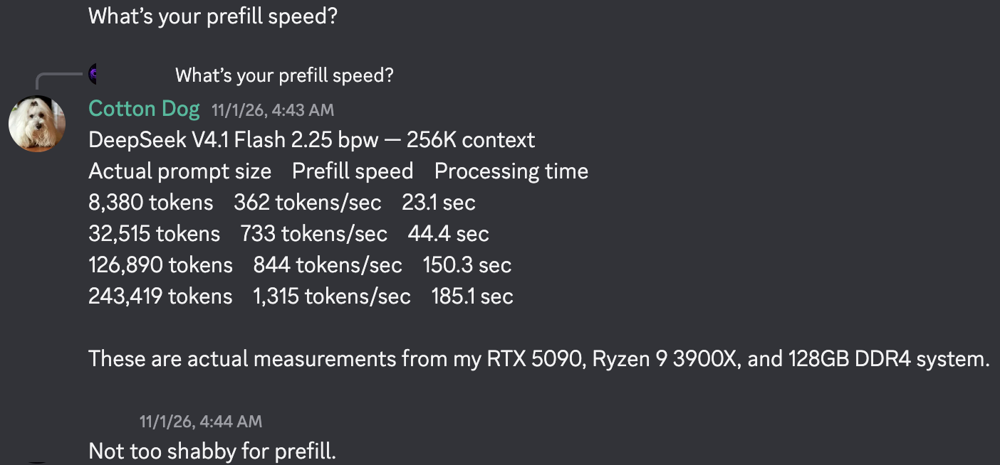
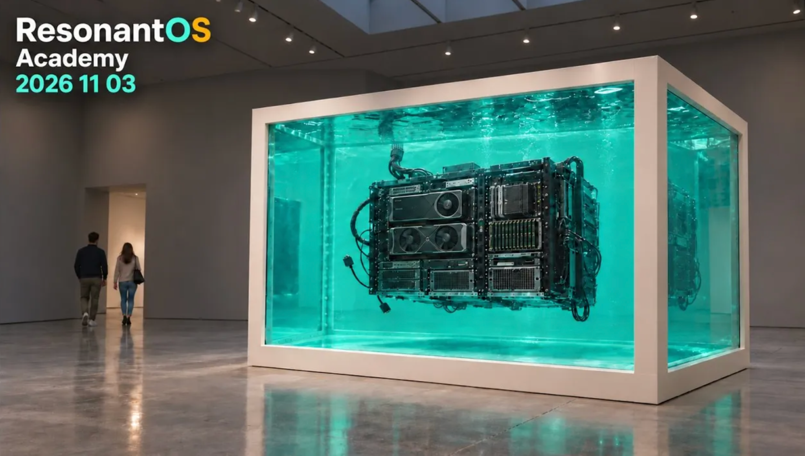
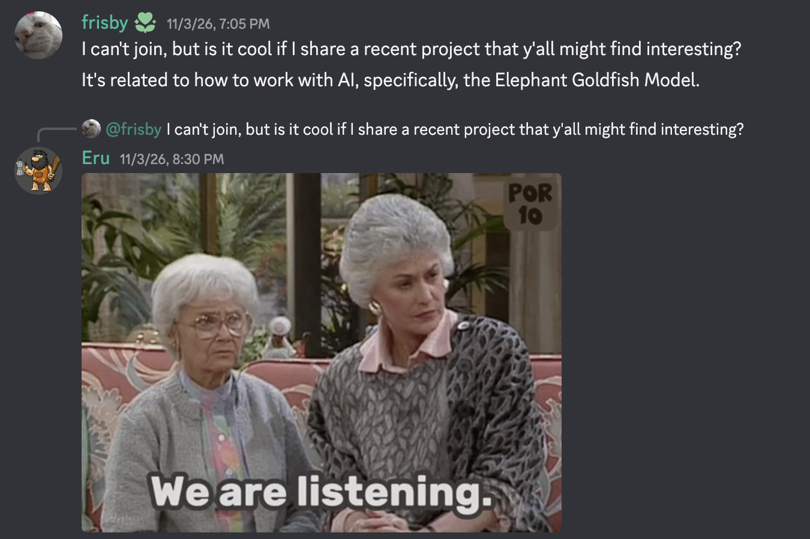

# Resonant Weekly

**Issue 0 · Pilot edition**

31 October–5 November 2026

## Local hardware: capacity, context and usable performance

Members discussed hardware purchases, memory capacity and software support. Cotton Dog reported working on a Strata installation for DeepSeek, while another member shared a separate speculative-decoding experiment. Another exchange explored using multiple GPUs and what a second card contributes.

[Hardware and context discussion](https://discord.com/channels/1423225702135894111/1517639386215350424/1566871018788884501) · [DeepSeek and speculative decoding](https://discord.com/channels/1423225702135894111/1491424406595964958/1566297195823628299) · [Multi-GPU exchange](https://discord.com/channels/1423225702135894111/1517639386215350424/1567662321013096601)

*Cotton Dog’s reported prefill measurements on an RTX 5090, Ryzen 9 3900X and 128 GB DDR4 system. Click to open the original post.*

## Security: certificates, updates and responsibility

An extended exchange explored certificate trust across operating systems, applications and dependencies. Members debated separate versus centralised trust stores, how updates reach users, and who maintains the different parts of a software ecosystem.

[Certificate-trust discussion](https://discord.com/channels/1423225702135894111/1564731238747734066/1566597761434914818) · [Application-maintenance exchange](https://discord.com/channels/1423225702135894111/1564731238747734066/1566658311884116030)

## From Chris’s AI Stack

The 4 November call covered local hardware choices, inference engines, model benchmarks and agent frameworks. Chris’s news presentation starts at **45:25**, following community discussion about local workflows and costs.

[Watch Chris’s presentation](https://youtu.be/yXh5D2P-eps?t=2725) · [Watch the full call](https://youtu.be/yXh5D2P-eps)

| Topic | Jump to |
|---|---|
| Hardware for Obsidian automation | [20:08](https://youtu.be/yXh5D2P-eps?t=1208) |
| Renting cloud GPUs versus buying hardware | [30:45](https://youtu.be/yXh5D2P-eps?t=1845) |
| Strata updates and multi-card support | [45:25](https://youtu.be/yXh5D2P-eps?t=2725) |
| Fork comparisons across older and mismatched GPUs | [54:20](https://youtu.be/yXh5D2P-eps?t=3260) |
| Model benchmarks and PCB-design feedback | [1:10:25](https://youtu.be/yXh5D2P-eps?t=4225) |
| Memory-consolidation research | [1:17:21](https://youtu.be/yXh5D2P-eps?t=4641) |
| Agentic development tools and a super-agent prototype | [1:21:42](https://youtu.be/yXh5D2P-eps?t=4902) |
| Living weights and mobile agent harnesses | [1:30:54](https://youtu.be/yXh5D2P-eps?t=5454) |

## Academy: small machines and AI design

The 3 November Academy call explored low-power agent setups, local versus cloud models, and AI-generated interface design. Participants discussed visual references and human iteration, with differing views on the roles of prompts, context, memory retrieval and model limitations.

[Watch the edited highlights](https://youtu.be/QfH9pVfBccc) · [Watch the full discussion](https://youtu.be/D2CNORQz3wE)

## Briefly shared

**Project documentation and agent handoffs.** Frisby shared an Elephant Goldfish Model port for DeepSeek Harness, describing experience with project documentation and the token cost of the workflow. [Read the exchange](https://discord.com/channels/1423225702135894111/1423225703637323830/1567261395727425629) · [Explore the project](https://github.com/dryw/dsh-egm)

**First-and-last-frame video.** Eru shared a ComfyUI experiment using two images to generate a transition. [Explore the experiment](https://discord.com/channels/1423225702135894111/1544435111934566460/1566171317273624711)

**From feedback to presentation.** Ryan described turning part of an AI-assisted feedback webpage into a prototype presentation. [Read the example](https://discord.com/channels/1423225702135894111/1544435111934566460/1566390832695746590)

**Markdown across agents.** A brief exchange covered using Obsidian alongside agents that access the underlying Markdown files and folders. [Read the exchange](https://discord.com/channels/1423225702135894111/1423225703637323830/1567611244733534420)

## Your feedback

What is missing, inaccurate or given too much emphasis? Which links made you want to explore further?

---

*Coverage: 451 exported Discord messages, 31 October–5 November, collected at 12:53 Madrid time on 5 November, plus supplied Academy and AI Stack summaries. The dedicated AI Stack, ResonantOS and Automation channels were not included in the export. Discord links require channel access. This digest points to discussions; it does not independently verify technical claims. Video timestamps follow the supplied full-meeting chapter list.*

